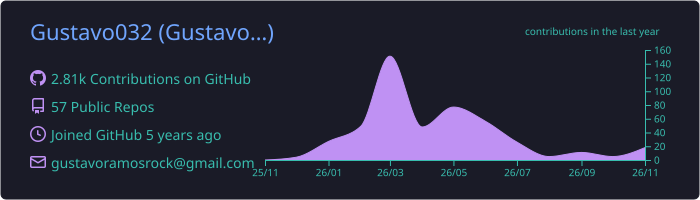
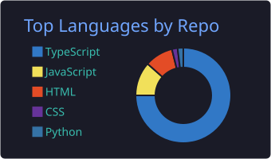
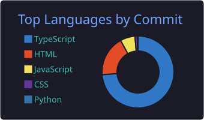

 

---

## 👨‍💻 Sobre mim

Sou desenvolvedor Full Stack com **mais de 4 anos em tecnologia**: comecei no suporte e na infraestrutura
e hoje construo sistemas web, mobile e IoT de ponta a ponta, do banco de dados ao deploy na VPS.

- 🏢 **Agora:** Desenvolvedor Full Stack na **M-Tech (MTechnologia)**, nos produtos *Eazyview* e *Workextra*
- 🚀 **Code Match:** CEO e dev da minha software house, com sistemas sob demanda para clientes
- 🎓 **Formação:** Engenharia de Software na Anhanguera (2024 - 2028)
- 🤖 **IA no fluxo:** Claude Code, Cursor e Codex fazem parte do meu dia a dia
- 🎯 **Busco:** vagas de desenvolvedor, analista de sistemas ou suporte/infra
- 📍 Itapevi - SP, Brasil

---

## 🧭 Trajetória

| Período | Cargo | Empresa | Destaques |
| :-- | :-- | :-- | :-- |
| Ago/2026 - hoje | Desenvolvedor Full Stack | **M-Tech (MTechnologia)** | Sistemas internos e externos, Eazyview e Workextra |
| Nov/2025 - Jul/2026 | Desenvolvedor Full Stack | **VKO Solution** | Telemetria IoT (MQTT, Raspberry Pi, ESP32), chamados, ativos, VPS |
| Nov/2024 - Fev/2025 | Analista de T.I. | **Magazine Luiza** (VMG) | Automações em Python/JS, sistema de coletores, rede corporativa |
| Mar/2024 - Out/2024 | Desenvolvedor / Suporte | **I Need T.I.** | Softwares em Node.js e React, servidores, suporte multiempresa |
| Mar/2023 - hoje | CEO & Desenvolvedor | **Code Match** | Agendamentos, landing pages, quizzes, hospedagem e firewall |
| Fev/2022 - Set/2023 | Auxiliar → Assistente de T.I. | **Contabilize** | Responsável pela T.I., servidores, LGPD, sistema de demandas |

---

## 🛠️ Stack

**Front-end & mobile** 

**Back-end & dados** 

**Infra, DevOps & IoT** 

**Ferramentas** 

---

## 🌟 Projetos em destaque

| Projeto | O que faz | Stack |
| :-- | :-- | :-- |
| [**Quiz Cultural EMLTC**](https://github.com/Gustavo032/quiz-cultural-emltc-itapevi) · [ao vivo](https://quiz-cultural-emltc-itapevi.vercel.app) | Projeto de extensão com a Escola Livre de Teatro e Circo de Itapevi: indica o curso ideal pra cada morador | React, TypeScript |
| [**Pedidos de Refeição**](https://github.com/Gustavo032/react-sistema-lunch) · [ao vivo](https://react-sistema-lunch.vercel.app) | Sistema web de pedidos de refeição para escola | React, TypeScript |
| [**Monitor de IPs**](https://github.com/Gustavo032/monitor_ips_python) | Monitora a disponibilidade dos equipamentos da rede e dispara alerta sonoro quando algum cai | Python |
| [**Controle de Coletores**](https://github.com/Gustavo032/coletores_react) | Retirada e devolução de coletores com histórico, filtros e login JWT por setor (Magazine Luiza) | React, TypeScript |
| [**API SOLID - Check-in em academias**](https://github.com/Gustavo032/ignite-nodejs-03-api-solid-nodejs) | API REST com SOLID, testes com Vitest, JWT e Prisma | Node.js, Fastify, Prisma |
| [**Enquetes em tempo real**](https://github.com/Gustavo032/NLW-Expert-NODE-JS) | Back-end de enquetes com votos ao vivo via WebSockets | Node.js, Fastify, Redis, WebSockets |

> Boa parte dos meus projetos de clientes (telemetria IoT, chamados, controle de ativos, painéis em nuvem) é privada.
> Veja mais no meu [portfólio](https://gustavo.codematch.com.br).

---

## 📊 GitHub em números

  
   
  
  
   
  

---

## 🎓 Cursos e certificados

- **CCNA v7: Introduction to Networks** - SENAI (2025)
- **Implantação de Serviços em Nuvem (AZ-900)** - SENAI (2024)
- **Segurança Cibernética** - SENAI (2024)
- **Formação Node.js** - Rocketseat (2024)
- **Formação ReactJS** - Rocketseat (2022)

<b>Ver certificados</b>

 

  <table>
    <tr>
      <td></td>
      <td></td>
      <td></td>
    </tr>
    <tr>
      <td></td>
      <td></td>
      <td></td>
    </tr>
    <tr>
      <td></td>
      <td></td>
      <td></td>
    </tr>
    <tr>
      <td></td>
      <td></td>
      <td></td>
    </tr>
    <tr>
      <td></td>
      <td></td>
      <td></td>
    </tr>
    <tr>
      <td></td>
    </tr>
  </table>

---

<picture>
  <source media="(prefers-color-scheme: dark)" srcset="https://raw.githubusercontent.com/Gustavo032/Gustavo032/output/github-snake-dark.svg" />
  
</picture>

